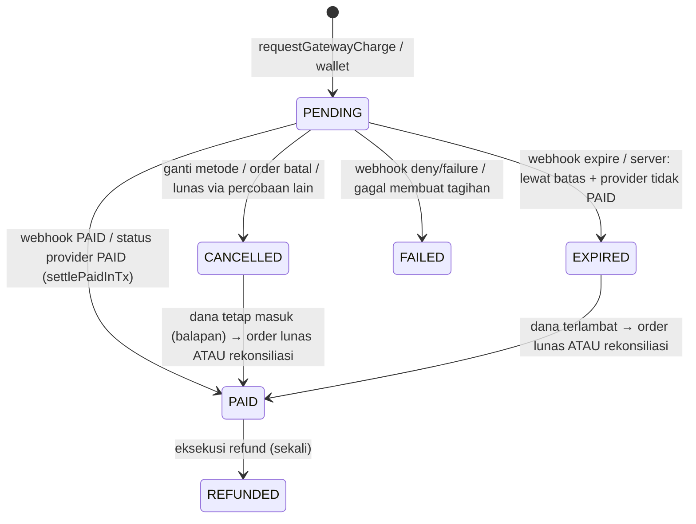

# 13 — Siklus Hidup Pembayaran (Fase 1 Batch 2 — T4, T5)

Status: **TESTED** (PostgreSQL nyata, gateway tiruan) · Midtrans sandbox **NOT_VERIFIED** · belum deploy.

## Akar masalah

| # | Masalah | Akar |
|---|---|---|
| T4 | Tidak bisa ganti metode bayar; "Ganti Metode" QRIS → VA tetap mengembalikan QR lama | Satu order = satu tagihan gateway (`PG-<orderNumber>`, juga `order_id` Midtrans). Panggilan kedua selalu mengembalikan tagihan pertama apa pun metodenya. |
| T4 | Bayar saldo ditolak selama QRIS aktif | Batch 1 sengaja menolak karena belum ada pembatalan tagihan. |
| T4 | Pembayaran kedua (QR lama tetap dibayar) diabaikan diam-diam | `settlePaidInTx` hanya `return` bila order sudah PAID → uang masuk tanpa catatan. |
| T5 | Kedaluwarsa hanya lewat webhook; klien tidak punya waktu server | `expiresAt` hanya di JSON respons; tidak ada verifikasi server setelah batas waktu. |
| Baru | `/payments/:n/simulate` & `/payments/webhook` bisa melunasi tanpa bayar di lingkungan non-produksi walau gateway Midtrans aktif | Hanya dijaga `APP_ENV`. |
| Baru | Refund admin me-refund pembayaran PAID *terakhir*, tidak melepas booking (mesin bisa dinyalakan dari order yang sudah direfund) | `payments[0]` + tidak ada `releaseBooking`. |

## Model data

```
orders 1 ──< payments (riwayat percobaan: PG-ORD, PG-ORD-2, PG-ORD-3, PAY-ORD …)
orders.paidPaymentId ──1 payments   (UNIK: pembayaran yang melunasi)
payments.pendingSlot = orderId selama PENDING  (UNIK: ≤1 percobaan aktif per order)
payments.expiresAt / provider / cancelledAt
payment_reconciliations (lihat 15)
```

Trigger `orders_financial_guard` (database): order CANCELLED/REFUNDED **tidak bisa** berubah ke status lain (mis. PAID), dan `paidPaymentId` harus pembayaran milik order itu sendiri — berlaku bahkan untuk SQL langsung.

## Status percobaan pembayaran



Order hanya menjadi PAID di **satu** fungsi: `PaymentsService.settlePaidInTx` (kunci baris order). Pembayaran PAID yang tidak bisa diterapkan:

| Kondisi saat dana masuk | Hasil |
|---|---|
| Order belum dibayar | Order PAID, `paidPaymentId` = pembayaran ini, percobaan lain → CANCELLED (+ dibatalkan di gateway) |
| Order sudah dilunasi pembayaran lain | Pembayaran PAID dicatat, **rekonsiliasi `DUPLICATE_PAYMENT`** |
| Order CANCELLED/REFUNDED | Pembayaran PAID dicatat, order tidak hidup lagi, **rekonsiliasi `PAID_AFTER_CANCEL`** |
| Order PAID tetapi slot mesin sudah diambil | Order PAID, booking CANCELLED, **rekonsiliasi `PAID_BOOKING_UNAVAILABLE`** |

## Ganti metode (QRIS ⇄ VA ⇄ saldo)

```mermaid
sequenceDiagram
  participant App
  participant API as PaymentsService
  participant DB as PostgreSQL
  participant GW as Midtrans
  App->>API: POST /payments/gateway {VA, BNI}
  API->>DB: TX1: lock order · validasi · percobaan aktif → CANCELLED · cadangkan percobaan baru (pendingSlot)
  API->>GW: expire tagihan lama (POST /v2/{id}/expire)
  alt ternyata sudah settlement
    GW-->>API: PAID
    API->>DB: settle tagihan lama; percobaan baru CANCELLED
    API-->>App: 409 "sudah dibayar"
  else
    API->>GW: charge baru (order_id = PG-ORD-n)
    API->>DB: TX2: lock order · periksa ulang · simpan tagihan · perpanjang HOLD mesin
    API-->>App: tagihan baru + serverTime + secondsRemaining
  end
```

- Metode & bank sama dan tagihan masih > 30 dtk → tagihan yang sama dikembalikan (idempoten).
- Permintaan paralel: `pendingSlot` unik → hanya satu percobaan aktif; percobaan yang sedang dibuat → 409 "tunggu".
- Saldo: TX1 membatalkan percobaan QRIS/VA aktif → expire di gateway → bila ternyata sudah dibayar, **saldo tidak dipotong** (409) → TX2 potong saldo + settle.
- Order dibatalkan → percobaan aktif CANCELLED di DB dan di-expire di gateway.
- Panggilan jaringan ke gateway **tidak pernah** di dalam transaksi DB; hasilnya diperiksa ulang di bawah kunci.

## Kedaluwarsa otoritatif server (T5)

- `payments.expiresAt` disimpan dari respons gateway (data lama di-backfill dari JSON).
- Respons status kini memuat `serverTime`, `secondsRemaining`, `canRetry`.
- `GET status` untuk percobaan PENDING yang lewat `expiresAt + PAYMENT_EXPIRY_GRACE_SECONDS` (default 60): tanya provider → PAID ⇒ settle; masih PENDING ⇒ paksa expire ⇒ cek lagi; error jaringan ⇒ tetap PENDING (tidak menebak).
- Scheduler `recover-stuck` menyapu percobaan PENDING yang lewat waktu (lihat 14).
- HOLD mesin diperpanjang sampai `expiresAt` tagihan + toleransi, sehingga slot tidak hilang selama pelanggan masih bisa membayar. Bila HOLD sudah habis dan slot diambil orang lain → tagihan **tidak** dibuat (409).

### Aplikasi

| | Mobile (QRIS & VA) | Kiosk |
|---|---|---|
| Hitung mundur | dari `secondsRemaining` server | dari `secondsRemaining` server |
| Hitung mundur habis | "Memastikan status pembayaran…" — tetap bertanya ke server | "Memastikan status…" |
| Polling berhenti | status ≠ PENDING, atau 3 menit setelah batas (tombol Cek Status tetap ada) | status ≠ PENDING |
| EXPIRED/FAILED/CANCELLED | Kartu status + "Buat Tagihan Baru" (bila `canRetry`) | Pesan + "Buat Tagihan Baru" (order yang sama) |
| Duplikasi | satu permintaan pada satu waktu; navigasi sukses sekali | satu polling pada satu waktu; layar sukses sekali |

## Penguatan verifikasi server

- `simulate` (mobile & kiosk) dan callback generik `/payments/webhook` hanya berfungsi bila gateway = `mock`. Dengan Midtrans aktif → 403 di lingkungan apa pun.
- Webhook Midtrans: signature SHA-512 + nominal harus sama (sudah ada) — tidak berubah.

## Endpoint

| Endpoint | Perubahan |
|---|---|
| `POST /payments/gateway` | ganti metode; idempoten per metode; percobaan baru `PG-<order>-<n>` |
| `GET /payments/:n/status` | + `serverTime`, `secondsRemaining`, `canRetry`; verifikasi provider setelah batas |
| `POST /payments/wallet`, `/wallets/customer/:id/pay` | boleh beralih dari QRIS/VA aktif |
| `POST /kiosks/device/payments` | jalur yang sama (pemilik = kiosk) |
| `POST /payments/:n/simulate`, `/payments/webhook` | hanya gateway mock |

## Rollback

Lihat 08. Kode lama tidak membaca kolom baru; nilai enum `CANCELLED` harus diubah ke `EXPIRED` sebelum rollback kode (kode lama tidak mengenalnya). Trigger dapat dihapus: `DROP TRIGGER orders_financial_guard ON orders;`.

## Risiko terbuka

- Perilaku Midtrans `expire`/`status` untuk QRIS (acquirer GoPay) & VA **belum diuji di sandbox** — adaptor diuji dengan respons tiruan.
- Bila expire di Midtrans gagal dan pelanggan tetap membayar QR lama → dana tercatat & muncul di rekonsiliasi (tidak hilang, tetapi butuh refund manual).
- Pembatalan order kini memanggil gateway secara sinkron (menambah latensi ≤ 15 dtk saat gateway lambat).
