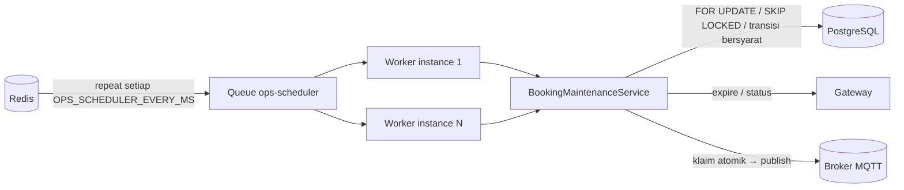

# 14 — Scheduler Booking & Pemulihan (Fase 1 Batch 2 — T9, S2)

Status: **TESTED** (PostgreSQL nyata, multi-worker) · Redis/BullMQ production & mesin fisik **NOT_VERIFIED** · belum deploy.

## Arsitektur

- Modul `OperationsModule` (`src/modules/operations/`), pola sama dengan scheduler loyalty/kampanye yang sudah ada.
- Job berulang dengan `jobId` tetap (`ops-expire-holds`, `ops-complete-bookings`, `ops-recover-stuck`) → restart/instance ganda tidak menumpuk jadwal. `attempts: 3`, backoff eksponensial.
- **Keamanan multi-worker berasal dari database**, bukan memori: kunci baris order → booking (urutan sama dengan webhook & pembatalan → tanpa deadlock), `SKIP LOCKED` pada booking, transisi `updateMany … where status = X`, advisory lock untuk penandaan "macet".

## Job

### A. `expire-holds`

| Kondisi | Aksi |
|---|---|
| HOLD lewat `expiresAt + BOOKING_HOLD_GRACE_SECONDS` | booking → EXPIRED; order DRAFT/WAITING_PAYMENT → CANCELLED (+ log); percobaan PENDING → EXPIRED lalu di-expire di gateway |
| Order masih punya tagihan aktif yang belum lewat batas | dilewati (pelanggan masih bisa membayar) |
| Order sudah PAID | dilewati |
| Dana ternyata masuk saat expire di gateway | settle → order sudah CANCELLED → rekonsiliasi `PAID_AFTER_CANCEL`, mesin tidak menyala |

### B. `complete-bookings`

| Kondisi | Aksi |
|---|---|
| Mesin melapor COMPLETED (realtime) | `handleDeviceEvent` → booking DONE + order PAID → COMPLETED dalam satu transaksi |
| IN_USE lewat `BOOKING_RUN_TIMEOUT_MINUTES` (90), event terakhir COMPLETED | DONE (event terlewat) |
| IN_USE lewat batas, tidak ada RUNNING dalam `BOOKING_RUNNING_FRESH_MINUTES` (10) | DONE (fallback durasi) + AuditLog `OPS_BOOKING_COMPLETED_FALLBACK` |
| IN_USE lewat batas, mesin MASIH melapor RUNNING | **tidak diselesaikan**; AuditLog `OPS_BOOKING_STUCK` (sekali) |
| RESERVED (sudah dibayar) lewat jendela pakai, tanpa START aktif | booking → EXPIRED + rekonsiliasi `PAID_NOT_USED` (keputusan admin: jadwal ulang/refund) |
| RESERVED lewat jendela tetapi START aktif | dilewati (mesin mungkin menyala) |

### C. `recover-stuck`

| Kondisi | Aksi |
|---|---|
| Pembayaran PENDING lewat batas | `syncPendingPayment` (verifikasi provider; PAID ⇒ settle; selain itu EXPIRED/FAILED) |
| Percobaan tanpa `externalId` > 5 menit (crash saat membuat tagihan) | FAILED |
| START PENDING > `IOT_START_REPUBLISH_SECONDS` (60) | dipublikasikan ulang — **klaim atomik** PENDING→PUBLISHED, hanya pemenang yang publish |
| START PUBLISHED/ACKED tanpa RUNNING > `IOT_START_ACK_TIMEOUT_MINUTES` (3) | TIMEOUT + AuditLog `OPS_START_TIMEOUT`; scan/kiosk boleh mencoba ulang (≤3); event RUNNING/COMPLETED terlambat **tetap diterima** |

## Perbaikan terkait

- `IotMachineService.markPublished`: klaim atomik sebelum publish (dulu baca-lalu-tulis → dua pemanggil paralel bisa mempublikasikan dua kali).
- `requestMachineStart`: TIMEOUT diperlakukan seperti FAILED (boleh dicoba ulang).

## Konfigurasi (env, semua opsional)

| Variabel | Default |
|---|---|
| `OPS_SCHEDULER_ENABLED` | `true` (`false` untuk instance khusus API) |
| `OPS_SCHEDULER_EVERY_MS` | 60000 |
| `OPS_SCHEDULER_BATCH` | 100 |
| `BOOKING_HOLD_GRACE_SECONDS` | 30 |
| `BOOKING_RUN_TIMEOUT_MINUTES` | 90 |
| `BOOKING_RUNNING_FRESH_MINUTES` | 10 |
| `IOT_START_ACK_TIMEOUT_MINUTES` | 3 |
| `IOT_START_REPUBLISH_SECONDS` | 60 |
| `PAYMENT_EXPIRY_GRACE_SECONDS` | 60 |

## Bukti uji

`test/integration/booking-scheduler.int-spec.ts` (12 test, PostgreSQL nyata): 4 worker paralel atas 15 HOLD → tepat 15 diproses; 3 worker penyelesaian → satu log COMPLETED; 4 worker publikasi ulang → MQTT dipanggil sekali; penandaan macet sekali walau 3 worker + ulang. Rinci di 16.

"Worker" di test = pemanggilan service yang sama secara konkuren (kunci yang diuji ada di PostgreSQL). Redis/BullMQ nyata tidak dijalankan di test.

## Rollback

Set `OPS_SCHEDULER_ENABLED=false` lalu restart → tidak ada job baru (job yang sedang berjalan selesai). Hapus jadwal di Redis: `ops-*` (opsional). Tidak ada perubahan skema khusus scheduler.

## Risiko terbuka

- Fallback durasi bisa menyelesaikan booking yang mesinnya sebenarnya masih berjalan bila mesin tidak mengirim event sama sekali (mitigasi: hanya bila tidak ada RUNNING baru, batas 90 menit, tercatat di audit).
- TIMEOUT START 3 menit: bila mesin sangat lambat lalu pelanggan mencoba ulang, START kedua bisa terkirim ke mesin yang sedang mulai (mesin umumnya mengabaikan START saat berjalan) — perlu konfirmasi perilaku firmware.
- Order otomatis dibatalkan saat HOLD kedaluwarsa (pelanggan perlu membuat pesanan baru).
