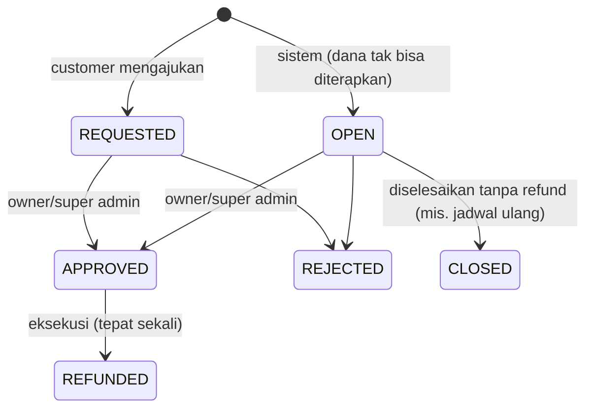

# 15 — Rekonsiliasi Keuangan & Alur Refund (Fase 1 Batch 2)

Status: **TESTED** (PostgreSQL nyata, HTTP + JWT asli) · belum deploy · kebijakan refund owner masih tertunda.

## Tabel `payment_reconciliations`

| Kolom | Isi |
|---|---|
| `paymentId`, `orderId`, `customerId` | pembayaran/order/customer terkait (customer NULL = tamu kiosk) |
| `amount`, `refundAmount` | nominal pembayaran & nominal yang perlu dikembalikan |
| `provider`, `providerRef` | gateway & ID transaksi provider |
| `reason` | `DUPLICATE_PAYMENT`, `PAID_AFTER_CANCEL`, `PAID_BOOKING_UNAVAILABLE`, `PAID_NOT_USED`, `CUSTOMER_REQUEST` |
| `status` | `OPEN`, `REQUESTED`, `APPROVED`, `REJECTED`, `REFUNDED`, `CLOSED` |
| `reviewedBy/At/Note` | keputusan admin |
| `refundMethod`, `executedBy/At`, `executionRef` | eksekusi (ID ledger saldo atau referensi refund eksternal) |

Unik `(paymentId, reason)` → pencatatan idempoten (webhook/job ganda tidak menggandakan). FK `RESTRICT` ke order & payment → riwayat tidak bisa terhapus. Jejak audit lengkap di `audit_logs` (`RECONCILIATION_CREATED / _APPROVE / _REJECT / _CLOSE / _EXECUTED`).

## Alur

| Aksi | Siapa | Endpoint |
|---|---|---|
| Ajukan refund order PAID miliknya | Customer | `POST /payments/refund-requests` |
| Lihat pengajuan sendiri | Customer | `GET /payments/refund-requests/mine` |
| Lihat daftar (lingkup outlet) | SUPER_ADMIN, OWNER, ADMIN_OUTLET | `GET /payments/reconciliations` |
| Setujui / tolak / tutup | **SUPER_ADMIN, OWNER** | `POST /payments/reconciliations/:id/review` |
| Eksekusi | **SUPER_ADMIN, OWNER** | `POST /payments/reconciliations/:id/execute` |
| Jejak audit | SUPER_ADMIN, OWNER | `GET /payments/reconciliations/:id/history` |

Kasir tidak melihat data refund (data keuangan). Panel admin: menu **Rekonsiliasi & Refund** (`/reports/reconciliations`). Mobile: "Butuh bantuan?" → **Ajukan refund** atau chat.

## Eksekusi

| Jenis alasan | Efek |
|---|---|
| Kelebihan dana (`DUPLICATE_PAYMENT`, `PAID_AFTER_CANCEL`) | pembayaran ekstra → REFUNDED; order tidak berubah |
| Refund order (`CUSTOMER_REQUEST`, `PAID_BOOKING_UNAVAILABLE`, `PAID_NOT_USED`) | pembayaran pelunas → REFUNDED; order → REFUNDED; booking yang belum dipakai dilepas. Ditolak bila mesin sedang/sudah dipakai |

| Metode | Efek |
|---|---|
| `WALLET_CREDIT` | kredit saldo MAIN customer lewat `WalletLedgerService` (idempotencyKey unik). Tidak untuk tamu kiosk |
| `EXTERNAL` | **hanya mencatat** refund yang dilakukan admin di luar sistem (dashboard Midtrans / transfer); wajib referensi |

**Tidak ada refund otomatis ke provider** dan tidak ada refund tanpa persetujuan.

### Tepat sekali (lapisan perlindungan)

1. Kunci baris order → rekonsiliasi (`FOR UPDATE`).
2. Status harus `APPROVED`; pembayaran harus `PAID`.
3. Transisi `APPROVED → REFUNDED` bersyarat (`updateMany`).
4. idempotencyKey ledger unik: `refund-recon-<id>` (kelebihan dana) atau `refund-order-<orderId>` — **sama** dengan refund admin langsung (`/wallets/orders/:id/refund`), sehingga dua jalur tidak bisa sama-sama mengkredit.

Refund admin langsung (jalur lama, tetap ada) kini: me-refund pembayaran pelunas (`paidPaymentId`), melepas booking, menolak bila mesin sedang dipakai, dan menutup pengajuan terbuka untuk order itu.

## Sumber catatan otomatis

| Sumber | Alasan |
|---|---|
| `settlePaidInTx`: order sudah dilunasi pembayaran lain | `DUPLICATE_PAYMENT` |
| `settlePaidInTx`: order CANCELLED/REFUNDED | `PAID_AFTER_CANCEL` |
| `settlePaidInTx`: slot mesin hilang | `PAID_BOOKING_UNAVAILABLE` |
| Scheduler: RESERVED dibayar tak dipakai | `PAID_NOT_USED` |
| Skrip `reconcile:legacy-bookings` | laporan `paidOnClosedOrders` (data lama, baca-saja) |

## Invarian keuangan (status)

| # | Invarian | Penegakan | Bukti |
|---|---|---|---|
| 1 | Order tidak dibayar dua kali | `orders.paidPaymentId` unik + kunci order; dana lain → rekonsiliasi | payment-lifecycle: 2 tagihan dibayar, saldo vs QRIS 10× |
| 2 | Satu pembayaran tidak melunasi dua order | `payments.orderId` tunggal + `paidPaymentId` unik + trigger | trigger test |
| 3 | Order batal tidak kembali PAID | kode + **trigger DB** | trigger test, batal vs pelunasan 8× |
| 4 | Booking kedaluwarsa/batal tidak bisa menyalakan mesin | validasi RESERVED (scan & kiosk); refund melepas booking | scheduler, reconciliation |
| 5 | Potong saldo tepat sekali | `PAY-<order>` unik + `pendingSlot` + kunci order | paralel rute lama/baru, saldo vs QRIS |
| 6 | Top-up tanpa pembayaran terverifikasi | top-up customer ditutup (K1) | reconciliation: topup 403 |
| 7 | Callback idempoten | settle hanya dari non-PAID di bawah kunci | webhook ganda 5× |
| 8 | QRIS/VA diverifikasi server | signature + nominal; status provider sebelum EXPIRED; simulate hanya mock | payment-lifecycle |
| 9 | Aktivasi mesin terikat order PAID valid | (Batch 1/1.5) + refund/expire melepas booking | kiosk-compat, scheduler |
| 10 | Refund dapat diaudit | tabel + audit_logs + FK RESTRICT | reconciliation: history |

## Keputusan owner yang dibutuhkan

1. Kebijakan refund resmi (siapa berhak, batas waktu, `PAID_NOT_USED` direfund atau tidak).
2. Apakah refund admin langsung tetap boleh untuk ADMIN_OUTLET (saat ini: ya, outlet sendiri) atau disamakan dengan alur persetujuan (SUPER_ADMIN/OWNER).
3. Prosedur refund EXTERNAL (Midtrans dashboard vs transfer) dan siapa yang memegang akses.
