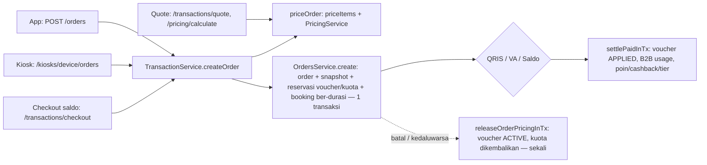

# 17 — Fase 1 Batch 3: Checkout & Pengalaman Mobile (T3, T10, S1, S4)

Status: **TESTED** (PostgreSQL nyata, mesin pricing asli) · belum deploy. IoT fisik ditunda (keputusan owner) — tidak ada perubahan MQTT/protokol perangkat.

## Ringkasan

| Temuan | Masalah | Sekarang |
|---|---|---|
| **T3** | Jalan pintas pemesanan di luar alur booking | Kedua pintu mesin (Lokasi → Pakai, Booking Mesin) sudah membuat order + booking atomik sejak Batch 1. Batch 3 menghapus sisa jalan pintas: `reserveMachine`/`reserveBooking` (klien), layar `CreateOrderScreen` (tak terjangkau, membuat order tanpa mesin), dan checkout kini menolak order mesin tanpa `deviceId`. |
| **T10** | Voucher & happy hour dipaksa ke Saldo; voucher dikirim sebagai `promoCode` sehingga tidak pernah berlaku di QRIS/VA | **Semua order dihargai oleh satu mesin pricing** (`TransactionService.priceOrder` → `PricingService`): `POST /orders` (app baru & lama), kiosk, checkout saldo, quote. Voucher & kuota happy hour **direservasi** saat order dibuat, dikonfirmasi saat PAID, dilepas saat batal/kedaluwarsa. QRIS, VA, saldo menagih total order yang sama. |
| **S1** | Ganti ke Saldo membuat order baru; DRAFT yatim tanpa aksi; detail order tak dipakai | Satu order untuk semua metode (saldo membayar order yang ada; `/transactions/checkout` menerima `orderId`). Halaman **Detail Order** baru: Lanjutkan Pembayaran (QRIS/VA/Saldo) & Batalkan; "Upload Bukti Bayar" dihapus. Scheduler membatalkan order belum dibayar yang ditinggalkan (`ORDER_UNPAID_TTL_MINUTES`, default 60) dan mengembalikan voucher/kuota. |
| **S4** | Dryer selalu 1 siklus | Pilihan 1–3 siklus. Harga, estimasi durasi, dan **lama booking mesin** dihitung server; konflik booking memakai durasi nyata. |

## Arsitektur harga terpadu

- `orders.pricingSnapshot` menyimpan rincian (base, B2B, happy hour, voucher, promo, poin, aturan, estimasi menit).
- `voucher_redemptions` status kini `RESERVED → APPLIED` (atau `RELEASED`); `userVoucherId` unik → satu voucher tidak bisa dipegang dua order.
- Kuota happy hour dikurangi atomik saat reservasi; kuota habis → 409 **sebelum** pembayaran (pelunasan tidak pernah gagal karena voucher/kuota).
- Checkout saldo tidak lagi membuat pembayaran sendiri: membuat order ber-harga lalu memanggil jalur bayar-saldo tunggal (`settlePaidInTx`). Gagal bayar → order baru dibatalkan (tanpa order yatim).
- Kiosk QRIS: promo & happy hour berlaku; **voucher pribadi tidak** (customer kiosk tanpa PIN). Voucher di kiosk tetap lewat checkout saldo ber-PIN.

## Validasi jumlah (server)

`priceItems` (dipakai semua jalur): jumlah > 0 (dulu `@IsNumber` saja — 0/negatif lolos), mesin cuci = 1, dryer = bilangan bulat 1–`MAX_DRYER_CYCLES` (3).

## Perubahan API

| Endpoint | Perubahan |
|---|---|
| `POST /orders` | Dipindah ke `OrderCreateController` (modul transactions); harga terpadu; `voucherCode` baru; `staffUserId` hanya dari staf |
| `POST /transactions/checkout` | `orderId` opsional (bayar order yang ada); kini lewat jalur bayar tunggal |
| `/transactions/quote`, `/pricing/calculate` | + `estimatedMinutes` |
| `GET /orders/:id` | + `machineBooking` (mesin, jadwal, durasi) |
| `POST /bookings/:id/cancel` | Order belum dibayar dibatalkan lewat `OrdersService.cancel` (kunci order, lepas voucher, batalkan tagihan aktif) |

## Migrasi

`20261121090000_order_pricing_snapshot` — aditif: `orders.pricingSnapshot` (JSONB), `orders.pricingReleasedAt`, `machine_bookings.durationMinutes`. Tanpa backfill. Rollback: kolom bisa dibiarkan (kode lama tidak membacanya); booking ber-durasi akan diperlakukan sebagai slot standar oleh kode lama.

## Kompatibilitas

| Klien | Hasil |
|---|---|
| App mobile lama | `POST /orders` (payload lama, tanpa voucher) → harga terpadu (happy hour kini juga berlaku untuk order QRIS app lama); reservasi lama tetap diikat; bayar saldo rute lama tetap jalan — `mobile-compat` 13/13 |
| App mobile baru | checkout satu order, siklus dryer, detail order |
| Kiosk | order QRIS lewat harga terpadu; checkout saldo ber-PIN — `kiosk-compat` 22/22 |
| Admin | tidak membuat order; `GET /orders/:id` hanya bertambah field — build sukses |
| IoT | tidak berubah (format START sama; siklus belum dikirim ke perangkat — lihat risiko) |

## Bukti uji

`test/integration/checkout-pricing.int-spec.ts` — 17 test, mesin pricing ASLI di PostgreSQL:
quote = total order = nominal QRIS = VA = potongan saldo (voucher + happy hour); voucher RESERVED → APPLIED; 1 voucher × 5 order paralel → 1; batal → voucher & kuota kembali (sekali) dan bisa dipakai ulang; kuota 2 × 5 paralel → tepat 2 berdiskon, sisanya 409 sebelum bayar; happy hour berlaku QRIS; checkout `orderId`; gagal bayar → order batal + voucher/mesin dilepas; 4 checkout paralel voucher sama → 1 lunas; scheduler membatalkan order ditinggalkan (tagihan aktif tidak disentuh); HOLD kedaluwarsa melepas voucher; dana setelah batal → rekonsiliasi; dryer 1–3 (harga, durasi, lama booking, bentrok dua arah); jumlah tidak valid ditolak; pratinjau `/pricing/calculate` = quote = total order.

Uji mutasi: pelepasan reservasi saat batal, batas siklus dryer, durasi booking baru dalam cek bentrok, kompensasi order gagal bayar → masing-masing membuat test gagal. Cek status voucher ACTIVE saat reservasi berlapis (validasi pricing + redemption unik) — mutasi tunggal tidak cukup.

## Sisa risiko

- **Siklus dryer belum dikirim ke perangkat**: perintah START tetap format lama (owner menunda integrasi IoT). Mesin fisik harus mengetahui jumlah siklus/durasi sebelum fitur ini dirilis ke outlet nyata.
- Refund order ber-voucher (alur rekonsiliasi / refund admin langsung) tidak mengembalikan voucher — sama seperti sebelumnya; `TransactionService.refund` lama tetap membalikkan voucher. Butuh keputusan kebijakan.
- Satu kegagalan intermiten tidak terulang (1 dari ±60 run suite konkurensi; nama test tidak tertangkap) — lihat PROGRESS.
- Midtrans sandbox, app di HP, UI admin di browser: NOT_VERIFIED.
