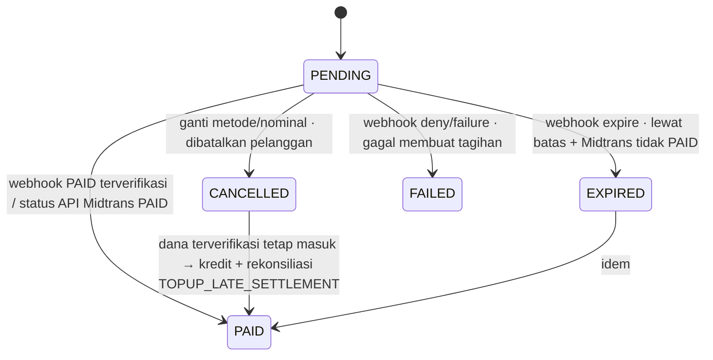

# 18 — Top-up Saldo Mandiri via Midtrans (Fase 2 / Batch 4)

Status: **TESTED** (PostgreSQL nyata, gateway tiruan) · Midtrans sandbox **NOT_VERIFIED** · belum deploy. Aplikasi: tetap di balik flag `ENABLE_WALLET_TOPUP` (default mati) sampai backend dideploy.

## Alur

```mermaid
sequenceDiagram
  participant App
  participant API as WalletTopupService
  participant DB as PostgreSQL
  participant MT as Midtrans
  App->>API: POST /wallets/me/topup {amount, method, bank?}
  API->>API: validasi nominal server (min/maks/biaya)
  API->>DB: TX: kunci customer · pakai ulang / batalkan top-up aktif · cadangkan TOP-yyyymmdd-n (pendingSlot)
  API->>MT: expire tagihan lama (bila ganti) · charge baru (order_id = TOP-…)
  API->>DB: TX: simpan tagihan bila masih PENDING
  API-->>App: QR/VA + serverTime + secondsRemaining
  MT-->>API: POST /payments/midtrans/webhook (signature SHA-512, nominal dicek)
  API->>DB: TX: kunci baris top-up · PAID? lewati : kredit ledger (idempotencyKey topup-<id>) + ledgerId unik + audit
  App->>API: GET /wallets/me/topups/:n (polling; lewat batas → verifikasi ke Midtrans)
  App->>App: baca ulang saldo dari server
```

Webhook top-up memakai endpoint Midtrans yang sama dengan pembayaran order: `PaymentsService` mencari pembayaran order; bila tidak ada, event diteruskan ke `WalletTopupService` (berdasarkan `order_id` `TOP-…` / `transaction_id`).

## Aturan (default pengembangan — BUKAN kebijakan komersial final)

| Variabel | Default |
|---|---|
| `TOPUP_MIN_AMOUNT` | 10.000 |
| `TOPUP_MAX_AMOUNT` | 1.000.000 per transaksi |
| `TOPUP_ADMIN_FEE` | 0 (ditagih = nominal + biaya; dikreditkan = nominal) |
| Cashback top-up | hanya bila ada kampanye `CASHBACK_TOPUP` aktif (default tidak ada) |
| `PAYMENT_EXPIRY_GRACE_SECONDS` | 60 (toleransi sebelum verifikasi ke provider) |

Nominal wajib bilangan bulat rupiah. `customerId` tidak pernah diterima dari klien — selalu dari JWT.

## Status top-up



## Invarian ledger

| Invarian | Penegakan | Bukti (wallet-topup.int-spec) |
|---|---|---|
| Satu top-up lunas = tepat satu kredit | kunci baris + transisi bersyarat + `ledgerId` unik + idempotencyKey `topup-<id>` | webhook ganda 6× paralel → 1 ledger |
| Callback ganda tidak menambah saldo dua kali | idem | idem |
| Gagal/kedaluwarsa tidak menambah saldo | hanya `settle()` yang mengkredit; dipanggil hanya dari status PAID terverifikasi | FAILED/EXPIRED → saldo 0 |
| Kedaluwarsa tanpa verifikasi tidak dikredit | status provider dicek dulu; error jaringan → tetap PENDING | lewat batas + provider PENDING → EXPIRED |
| Top-up paralel konsisten | `pendingSlot` unik (≤1 aktif per customer) + kunci customer | 6 permintaan paralel → 1 aktif; 5 customer paralel → saldo = ledger |
| Kepemilikan di server | customer dari JWT; top-up orang lain → 404 | lihat test otorisasi |
| Ledger = saldo | diperiksa di test (Σkredit − Σdebit = saldo MAIN) | beberapa test |
| Respons "sukses" klien tidak dipercaya | tidak ada endpoint untuk menandai lunas; `simulate` hanya gateway mock | simulate dengan gateway ≠ mock → 403 |

## Top-up terlambat lunas — rekonsiliasi & refund

| Syarat | Penegakan | Bukti |
|---|---|---|
| Tepat satu kredit ledger | kunci baris top-up + transisi bersyarat + `ledgerId` unik + idempotencyKey | webhook ×2 + polling + scheduler PARALEL → 1 kredit |
| Kasus rekonsiliasi yang dapat diaudit | `payment_reconciliations` (TOPUP_LATE_SETTLEMENT, OPEN) + audit `RECONCILIATION_CREATED` / APPROVE / EXECUTED | riwayat 3 langkah |
| Tidak dikredit dua kali | idem; top-up PAID **atau REFUNDED** → pelunasan berikutnya no-op | webhook PAID setelah refund → saldo tetap |
| Refund eksternal memperhitungkan kredit saldo | eksekusi rekonsiliasi top-up hanya `EXTERNAL` + referensi, setelah disetujui SUPER_ADMIN/OWNER, dan **dalam transaksi yang sama** mendebit saldo sebesar nominal kredit (`TOPUP_REFUND`, idempotencyKey `topup-refund-<id>`) | saldo 25.000 → 0, ledger = saldo |
| Tidak ada kredit + refund bersamaan tanpa kompensasi | debit kompensasi & status REFUNDED & rekonsiliasi REFUNDED atomik; saldo kurang (sudah dibelanjakan) → ditolak 409 tanpa efek | saldo terpakai → 409, 0 ledger |
| Eksekusi tepat sekali | kunci baris + transisi bersyarat + idempotencyKey | 4 eksekusi paralel → 1 debit |

`WALLET_CREDIT` ditolak untuk top-up (saldo sudah dikreditkan). Admin tetap bisa **CLOSE** (pelanggan menyimpan saldo).

## Endpoint

| Endpoint | Fungsi |
|---|---|
| `POST /wallets/me/topup` | buat/pakai ulang tagihan (QRIS/VA) |
| `GET /wallets/me/topups` | riwayat (50 terakhir) |
| `GET /wallets/me/topups/:n` | status (verifikasi provider bila lewat batas) |
| `POST /wallets/me/topups/:n/cancel` | batalkan (bila provider ternyata PAID → dikreditkan) |
| `POST /wallets/me/topups/:n/simulate` | DEV — hanya gateway mock & bukan produksi |
| `POST /wallets/customer/:id/topup`, `POST /transactions/topup` | tetap hanya admin (top-up manual, K1) |

Scheduler `recover-stuck` menyinkronkan top-up PENDING yang lewat batas (aman multi-worker).

## Aplikasi mobile

Saldo → Top Up: saldo saat ini, nominal cepat/manual (validasi awal 10rb–1jt), QRIS atau VA (BCA/BRI/BNI/Permata) → halaman QRIS/VA yang sama dengan pembayaran order (hitung mundur dari server, polling berhenti saat final, "Buat Tagihan Baru") → setelah lunas saldo dibaca ulang dari server → dialog hasil. Riwayat top-up di halaman yang sama. Tombol dikunci saat memproses (tanpa pengiriman ganda).

## Migrasi

`20261122085900_reconciliation_topup_reason` (enum) dan `20261122090000_wallet_topup_pin` (tabel `wallet_topups` [status termasuk REFUNDED, `refundedAt`], tabel `wallet_pin_proofs`, `payment_reconciliations.orderId` nullable + `topupId`). Aditif. Rollback: lihat 08.

## Risiko terbuka

- Perilaku Midtrans `expire`/`status` untuk order_id `TOP-…` belum diuji di sandbox.
- Refund top-up normal (bukan terlambat) atas permintaan pelanggan belum ada alurnya; top-up terlambat dapat direfund eksternal dengan debit kompensasi.
- Refund eksternal dilakukan manual oleh admin (dashboard Midtrans / transfer) — sistem mencatat & membalik kredit, tidak mentransfer uang.
- Biaya admin & batas nominal adalah default pengembangan — perlu keputusan komersial owner.
