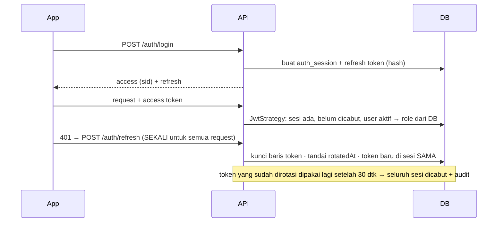

# 21 — Autentikasi, Refresh Token & Manajemen Akun (Batch 5 — T1, T6, T7, T11)

Status: **ACCEPTED (gate lokal)** — PostgreSQL nyata via HTTP + JWT asli (5 run berurutan suite penuh 222/222), app mobile diuji dengan server tiruan · belum deploy · WhatsApp (Fonnte) nyata **NOT_VERIFIED**.

## Temuan audit (sebelum Batch 5)

| # | Temuan | Dampak | Status |
|---|---|---|---|
| **A1 (KRITIS, baru)** | `POST /auth/register` publik menerima `role` apa pun; selain CUSTOMER **tanpa OTP**, cukup email | Siapa pun bisa membuat akun **SUPER_ADMIN** dan langsung mendapat token | **TESTED** — hanya CUSTOMER; lainnya 403 |
| A2 | Logout / reset password / nonaktifkan akun / ganti role tidak mematikan access token | Token curian / staf yang dinonaktifkan tetap bisa dipakai sampai kedaluwarsa | **TESTED** — sesi dicek per request |
| A3 | Rotasi refresh token tidak atomik | Dua refresh paralel dengan token yang sama → dua pasang token | **TESTED** — kunci baris |
| A4 | Token tanpa `jti` → dua token pada detik yang sama identik → `tokenHash` bentrok | Login/refresh paralel → **500** | **TESTED** — `jwtid` acak |
| A5 | Token yang dicabut langsung dihapus (housekeeping) | Pemakaian ulang refresh token curian tidak terdeteksi | **TESTED** — deteksi reuse |
| A6 | Login tanpa batas percobaan per akun (hanya throttle per IP) | Tebakan password terdistribusi | **TESTED** — kunci 10×/15 mnt, aman paralel |
| A7 | Role di `req.user` diambil dari isi token | Token lama tetap membawa role lama | **TESTED** — role dari database |
| A8 | Tidak ada ganti password di aplikasi; admin mengganti password tidak mengeluarkan sesi | — | **TESTED** |
| A9 | Verifikasi OTP tidak atomik; kode dari `Math.random` | Tebakan paralel melewati batas 5×/kode | **TESTED** — kunci baris + CSPRNG |
| A10 | Token verifikasi reset password bisa dipakai berulang selama 15 menit | Reset berulang dengan satu OTP | **TESTED** — sekali pakai |
| A11 | Registrasi paralel nomor sama → 500; user tanpa customer bila gagal di tengah | — | **TESTED** — transaksi + 409 |
| A12 | Hapus user yang punya riwayat → 500 | — | **TESTED** — 409 "nonaktifkan saja" |
| **T1** | App mobile tidak pernah me-refresh saat 401 | Pengguna "keluar" tiba-tiba / request gagal setelah 15 menit | **TESTED** |
| **T6** | Nomor HP tidak dinormalisasi (`08…`, `+62…`, `62…`) | Gagal login / akun ganda / OTP ke nomor salah | **TESTED** |
| **T7** | `WA_API_KEY` kosong → OTP hanya di-log tetapi klien menerima "OTP terkirim" — juga di production; gagal kirim → 500 | OTP bocor ke log production; pengguna menunggu kode yang tidak pernah datang | **TESTED** (kode); pemasangan kunci = tugas server |
| **T11** | `NSCameraUsageDescription` tidak ada | iOS menghentikan app saat membuka kamera (scan QR) | **IMPLEMENTED** (plist valid; belum diuji di iPhone) |

> **Tindakan owner (A1):** celah A1 kemungkinan besar juga ada di server yang sedang berjalan. Disarankan: (1) prioritaskan deploy perbaikan ini; (2) periksa tabel `users` production untuk akun ber-role staf/admin yang tidak dikenal (`SELECT id, email, role, "createdAt" FROM users WHERE role <> 'CUSTOMER' ORDER BY "createdAt" DESC;`). Pemeriksaan ini **tidak** dilakukan — tidak ada akses ke data production.

## Desain sesi

```
users 1 ──< auth_sessions (satu login di satu perangkat)
auth_sessions 1 ──< refresh_tokens (rotasi; rotatedAt, revokedAt)
access token = { sub, role, sid, jti }   refresh token = { sub, sid, jti }
```



| Aturan | Penegakan |
|---|---|
| Satu refresh token = satu pasangan token baru | `SELECT … FOR UPDATE` pada baris token di dalam transaksi |
| Pemakaian ulang token curian | token `rotatedAt` dipakai lagi setelah `AUTH_REFRESH_REUSE_GRACE_SECONDS` (30) → sesi `REFRESH_REUSE_DETECTED`, audit `AUTH_REFRESH_REUSE_DETECTED`. Dalam masa tenggang (balapan sah, mis. dua tab) → 401 saja |
| Pencabutan berlaku seketika | `JwtStrategy` membaca `auth_sessions` + `users.isActive` setiap request |
| Token lama (sebelum Batch 5, tanpa `sid`) | access: diterima sampai kedaluwarsa bila user aktif & terbit setelah `passwordChangedAt`; refresh: dirotasi lalu dipindah ke sesi baru (app lama tidak logout) |
| Role | dari database, bukan dari token |
| Bukti PIN wallet (Batch 4) | kini terikat **sesi** (`sid`), bukan string access token → tetap berlaku setelah access token di-refresh pada sesi yang sama, ditolak di sesi lain atau setelah sesi dicabut |

### Pemicu pencabutan sesi

| Kejadian | Cakupan | Alasan tercatat |
|---|---|---|
| `POST /auth/logout` | sesi ini | `LOGOUT` |
| `POST /auth/logout-all` | semua sesi | `LOGOUT_ALL` |
| `DELETE /auth/sessions/:id` | satu sesi milik sendiri | `USER_REVOKED` |
| Ganti password (`/auth/password/change`) | semua sesi **lain** | `PASSWORD_CHANGED` |
| Reset password via OTP | semua sesi; kunci login dibuka | `PASSWORD_RESET` |
| Admin: nonaktifkan akun / set password / ganti role | semua sesi user | `ACCOUNT_DEACTIVATED` / `ADMIN_PASSWORD_SET` / `ROLE_CHANGED` (+ audit `AUTH_SESSIONS_REVOKED_BY_ADMIN`) |
| Refresh token dipakai ulang | sesi itu | `REFRESH_REUSE_DETECTED` |

## Endpoint

| Endpoint | Perubahan |
|---|---|
| `POST /auth/register` | hanya CUSTOMER (role lain 403), nomor dinormalisasi, user+customer+sesi dalam satu transaksi, duplikat paralel 409 |
| `POST /auth/login` | identifier nomor dalam format apa pun; email tidak peka huruf besar; penguncian per akun (429); membuat sesi |
| `POST /auth/refresh` | rotasi atomik + deteksi reuse |
| `POST /auth/logout` | mencabut sesi ini (refresh token milik orang lain diabaikan) |
| `POST /auth/logout-all` · `GET /auth/sessions` · `DELETE /auth/sessions/:id` | **baru** |
| `POST /auth/password/change` | **baru** — `{currentPassword, newPassword}`; ikut penguncian login |
| `POST /auth/password/reset` | token verifikasi sekali pakai; nomor dinormalisasi |
| `POST /auth/otp/request` | nomor dinormalisasi; production tanpa `WA_API_KEY` → 503; gagal kirim → 503 + kode dihapus |
| `POST /auth/otp/verify` | atomik (5 salah per kode, aman paralel); satu kode → satu token |
| `PATCH /users/:id` (admin) | nomor dinormalisasi & cek duplikat lintas format; nonaktif/password/role → cabut sesi |
| `DELETE /users/:id` | user berriwayat → 409 |

Kode status: kredensial salah 401 (pesan sama untuk user tidak dikenal), akun terkunci **429**, password lama salah 400, sesi berakhir 401 "Sesi berakhir. Silakan masuk lagi.".

## Normalisasi nomor (T6)

- `normalizePhone()` → `628…` (10–15 digit, nomor seluler Indonesia). Dipakai di register, login, OTP, reset, admin buat/ubah user & customer, lookup customer kiosk.
- Data lama tidak wajib diubah: pencarian memakai `phoneCandidates()` (`628…`, `08…`, `+628…`, `8…`).
- Dua akun lama dengan nomor setara: login berhasil hanya bila password cocok **tepat satu** akun; reset password → 409 "hubungi layanan pelanggan".
- Skrip `npm run normalize:user-phones` — **dry-run default**, laporan JSON (CANONICAL / NORMALIZE / CONFLICT / INVALID). `--apply --actor "<nama>"` hanya mengubah NORMALIZE, per baris dengan pemeriksaan ulang + AuditLog. Diuji di DB uji; **belum dijalankan** di development/production.

## OTP WhatsApp (T7)

| Kondisi | Hasil |
|---|---|
| `APP_ENV=production`, `WA_API_KEY` kosong | 503 "Layanan pengiriman OTP sedang tidak tersedia" — tidak ada kode dibuat, tidak ada OTP di log |
| Provider gagal / timeout 10 dtk | 503 "Gagal mengirim OTP via WhatsApp…", kode dihapus (tidak bisa diverifikasi, tidak menghabiskan kuota 3/jam) |
| Non-production tanpa kunci | dev-fallback: pesan dicatat di log (seperti sebelumnya) |

Kode tetap **4 digit** (UI app meminta 4 digit) tetapi dari CSPRNG; batas 5 salah per kode dan 3 kode per jam per nomor (semua format).

## Aplikasi

**Mobile**
- T1: `ApiClient.onUnauthorized` → `AuthController.handleUnauthorized`: satu refresh untuk semua request paralel; request diulang **sekali** dengan token baru; request lain yang membawa token lama langsung memakai token terbaru. Refresh ditolak (401/403) → logout lokal + "Sesi berakhir. Silakan masuk lagi." di layar login. Error jaringan/5xx saat refresh → sesi dipertahankan.
- Menu Akun: **Edit Profil** (layar lama kini terhubung — R3), **Ubah Kata Sandi** (baru), **Keluar dari Semua Perangkat** (baru, dengan konfirmasi).
- T11: `NSCameraUsageDescription` di `ios/Runner/Info.plist`.

**Admin**: `useApi` + store memakai satu jalur refresh bersama (tidak lagi me-refresh paralel dengan token yang sama), membaca refresh token terbaru dari `localStorage` (tab lain mungkin sudah merotasi), dan mengulang request **sekali**.

**Kiosk**: tidak berubah (token perangkat, bukan JWT pengguna).

## Konfigurasi

| Variabel | Default | Catatan |
|---|---|---|
| `AUTH_LOGIN_MAX_ATTEMPTS` | 10 | 0 = nonaktif |
| `AUTH_LOGIN_LOCK_MINUTES` | 15 | reset password membuka kunci |
| `AUTH_REFRESH_REUSE_GRACE_SECONDS` | 30 | |
| `AUTH_SESSION_MAX_DAYS` | 0 | 0 = tanpa batas absolut (perilaku lama); keputusan owner |
| `WA_API_KEY` | — | **wajib** di production agar OTP berfungsi |

## Bukti

- `auth-session.int-spec.ts` — 35 test (PostgreSQL nyata, HTTP + JWT asli): registrasi role istimewa 403 (4 role) · alur OTP→register kanonik · 5 registrasi paralel → 1 akun · login lintas format nomor · OTP REGISTER lintas format 409 · nomor tidak valid 400 · akun ganda lintas format · kunci 10× → 429 · **20 tebakan paralel → tepat 9×401 + 11×429** · password benar di tengah banjir tebakan tetap ditolak · pesan sama untuk user tidak dikenal · 5 login paralel tanpa 500 · rotasi & masa tenggang · **8 refresh paralel → tepat 1 berhasil** · reuse setelah tenggang → sesi dicabut + audit · refresh token lama dipindah ke sesi · token palsu 401 · logout seketika · logout dengan token orang lain tidak berefek · logout-all · daftar/cabut sesi (orang lain 404) · nonaktifkan akun seketika · admin ganti role/password → sesi dicabut · token lama tanpa sesi ditolak bila nonaktif/password diganti · role dari DB · ganti password · ganti password ikut penguncian · reset password sekali pakai & buka kunci · production tanpa kunci WA 503 · gagal kirim 503 · **10 tebakan OTP paralel → 5 dihitung** · verifikasi paralel → 1 token.
- `phone-normalization.int-spec.ts` — 2 test (laporan & penerapan).
- `wallet-pin.int-spec.ts` — +1 test: bukti PIN terikat `sid`.
- Unit: `phone.util.spec.ts` (19).
- Flutter: `session_refresh_test.dart` (7) — refresh sekali untuk 3 request paralel, POST diulang sekali, endpoint yang tetap 401 tidak memicu loop, refresh ditolak → logout + pesan, server error → sesi tetap, 401 login tidak me-refresh, token terbaru dipakai ulang.

Uji mutasi (kode dirusak → test gagal): pemeriksaan role register · kunci baris refresh · deteksi reuse · cek `revokedAt` sesi di JwtStrategy · role dari DB · kunci baris login · kunci baris OTP · token reset sekali pakai · pencabutan sesi oleh admin · penghapusan kode OTP gagal kirim · kunci bukti PIN per sesi · kepemilikan refresh token saat logout · (mobile) refresh tunggal · (mobile) ulang sekali — **semua tertangkap**.

## Migrasi & rollback

`20261123090000_auth_sessions_account_security` — aditif: tabel `auth_sessions`; `refresh_tokens.sessionId` (FK, cascade) + `rotatedAt`; `users.passwordChangedAt`, `failedLoginAttempts`, `loginLockedUntil`. Lihat 08.

## Risiko terbuka

- **A1 di server berjalan** — lihat tindakan owner di atas.
- Pengiriman WhatsApp nyata (Fonnte) belum diuji; `WA_API_KEY` harus dipasang di server.
- Penguncian login per akun bisa dipakai pihak lain untuk mengunci akun korban 15 menit (trade-off umum); korban bisa membuka lewat reset password OTP.
- Refresh token di app mobile disimpan di secure storage; di admin web di `localStorage` (risiko XSS — sudah tercatat sejak sebelum Batch 5; ideal: cookie httpOnly).
- `JWT_ACCESS_EXPIRES_IN` di server belum diketahui; bila panjang, token lama tanpa sesi tetap berlaku sampai kedaluwarsa (tetap dicek user aktif & `passwordChangedAt`).
- Penghapusan akun mandiri (kewajiban Google Play untuk app yang punya pendaftaran akun) **belum ada** — butuh keputusan owner soal saldo wallet & data transaksi.
- App lama (sebelum Batch 5) tetap tanpa refresh otomatis saat 401 sampai pengguna memperbarui app.
