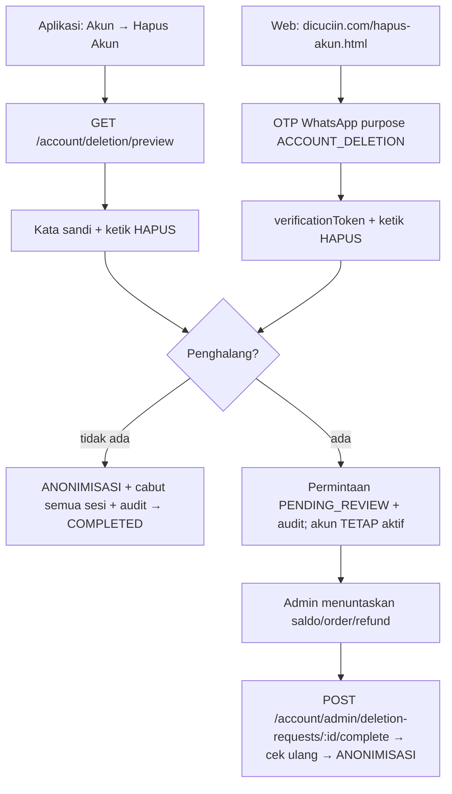

# 22 — Hapus Akun Mandiri (Batch 6 — Task C)

Status: **TESTED** (PostgreSQL nyata, HTTP + JWT asli) · **NONAKTIF secara default** (`ACCOUNT_DELETION_ENABLED=false`) sampai owner menyetujui kebijakan di §6 · belum deploy · halaman web belum diuji di browser.

## 1. Tujuan

Memenuhi kewajiban toko aplikasi (Google Play / App Store: aplikasi yang memungkinkan pendaftaran akun wajib menyediakan penghapusan akun **di dalam aplikasi dan lewat web**) dan hak subjek data (UU 27/2022 PDP), **tanpa** menghapus catatan keuangan yang wajib disimpan.

## 2. Alur

| Langkah | Penegakan |
|---|---|
| Re-autentikasi aplikasi | kata sandi via `checkPassword` (ikut penguncian login 10×/15 mnt) + ketik `HAPUS` |
| Re-autentikasi web | OTP WhatsApp ke nomor akun (purpose `ACCOUNT_DELETION`, 5 salah/kode, 3 kode/jam), token 15 menit, + ketik `HAPUS` |
| Hanya pelanggan | akun staf/admin → 403 (dikelola owner lewat Kelola Staff) |
| Satu proses per akun | `SELECT … FROM users … FOR UPDATE`; 5 permintaan paralel → 1 penghapusan, 1 audit |
| Fitur dimatikan | `ACCOUNT_DELETION_ENABLED≠true` → 403 + arahan ke layanan pelanggan (aplikasi menampilkan tombol WhatsApp & halaman web) |

## 3. Penghalang (penghapusan ditunda, bukan ditolak diam-diam)

| Kode | Kondisi | Alasan |
|---|---|---|
| `WALLET_BALANCE` | saldo utama > 0 | uang nyata milik pelanggan — dikembalikan dulu (kebijakan §6.1) |
| `ORDER_IN_PROGRESS` | order PAID…OUT_FOR_DELIVERY | layanan sudah dibayar belum selesai |
| `ORDER_AWAITING_PAYMENT` | order WAITING_PAYMENT | bisa jadi dibayar setelah akun hilang |
| `ACTIVE_BOOKING` | booking HOLD/RESERVED/IN_USE | mesin sedang dipesan/dipakai |
| `PENDING_PAYMENT` | pembayaran PENDING | dana bisa masuk sesudahnya |
| `PENDING_TOPUP` | top-up PENDING | idem |
| `OPEN_REFUND_CASE` | rekonsiliasi OPEN/REQUESTED/APPROVED | kewajiban refund belum tuntas |

Ada penghalang → `account_deletion_requests` berstatus **PENDING_REVIEW** (satu per akun; diajukan ulang = diperbarui), audit `ACCOUNT_DELETION_REQUESTED`, akun dan data **tidak berubah**. Admin (SUPER_ADMIN/OWNER) melihatnya di **Admin → Hapus Akun**, menuntaskan (mis. mengembalikan saldo lewat Rekonsiliasi & Refund), lalu **Selesaikan** — server memeriksa ulang semua penghalang (409 bila masih ada).

## 4. Apa yang dihapus / disimpan

| Data | Perlakuan |
|---|---|
| `users`: nama, email, nomor HP, foto, `phoneVerifiedAt` | dianonimkan (`Pengguna Dihapus`, null) |
| `users.passwordHash` | diganti hash acak (tidak bisa login); `isActive=false`, `deletedAt` |
| `customers`: tanggal lahir, gender, pekerjaan, hash PIN | dihapus (null) |
| `customer_addresses` | dianonimkan (dirujuk order lama, tidak dihapus) |
| bukti PIN, notifikasi, kode OTP nomor tsb. | dihapus |
| sesi login & refresh token | **dicabut semua** (access token langsung 401) |
| order, pembayaran, ledger saldo & poin, top-up, rekonsiliasi, audit log, ulasan (rating & komentar) | **disimpan utuh** — tidak lagi tertaut identitas |
| `customers.memberCode`, wallet (saldo 0) | disimpan (kunci referensi transaksi) |
| Poin & saldo bonus | hangus (bukan uang; tidak ada ledger baru) — ditampilkan di layar konfirmasi |
| Nomor HP | bebas dipakai mendaftar akun baru |

Audit `ACCOUNT_DELETED` hanya memuat `channel`, `requestId`, `by` (SELF/ADMIN) — **tanpa** data pribadi (diuji).

## 5. Endpoint

| Endpoint | Akses |
|---|---|
| `GET /account/deletion/preview` | pelanggan (JWT) |
| `POST /account/deletion` `{password, confirm:"HAPUS", reason?}` | pelanggan (JWT), throttle 5/menit |
| `POST /auth/otp/request` · `/auth/otp/verify` purpose `ACCOUNT_DELETION` | publik (nomor harus terdaftar) |
| `POST /account/deletion/web` `{phone, verificationToken, confirm, reason?}` | publik, throttle 5/menit |
| `GET /account/admin/deletion-requests?status=` · `POST …/:id/complete` · `POST …/:id/cancel` | SUPER_ADMIN, OWNER |

Halaman web: `dicuciin-landing/hapus-akun.html` (alamat API tetap `https://api.dicuciin.com/api/v1`, sengaja tidak bisa ditimpa lewat URL agar tautan palsu tidak bisa mencuri kode OTP).

## 6. Keputusan owner SEBELUM mengaktifkan (`ACCOUNT_DELETION_ENABLED=true`)

1. **Saldo tersisa.** Usulan (sudah diterapkan): penghapusan ditunda sampai saldo 0; saldo dikembalikan lewat jalur refund resmi (transfer) oleh admin. Alternatif yang **tidak** diterapkan: saldo hangus dengan persetujuan pelanggan — berisiko hukum (dana pelanggan) dan butuh ledger penutupan.
2. **Poin & saldo bonus hangus** — setuju? (bisa diubah menjadi penghalang).
3. **Ulasan:** saat ini rating & komentar disimpan (penulis dianonimkan). Bila owner ingin, komentar dapat dikosongkan saat penghapusan.
4. **Masa simpan catatan keuangan** (umumnya 10 tahun untuk dokumen perpajakan/akuntansi) — tetapkan dan cantumkan di kebijakan privasi.
5. **Kebijakan Privasi** (`kebijakan-privasi.html` §5–6): tambahkan tautan ke halaman Hapus Akun & ringkasan §4 di atas. Teks hukum TIDAK diubah otomatis — perlu ditinjau owner.
6. **Tanpa masa tenggang:** penghapusan berlaku seketika setelah konfirmasi (tidak bisa dibatalkan). Alternatif: masa tenggang 7–30 hari — belum diterapkan.
7. **Isi formulir Data safety / URL hapus akun** di Google Play Console: `https://dicuciin.com/hapus-akun.html`.
8. **CORS:** `CORS_ORIGINS` server wajib memuat `https://dicuciin.com` agar halaman web dapat memanggil API.
9. **`WA_API_KEY`** harus aktif (jalur web memakai OTP WhatsApp).

## 7. Bukti

`account-deletion.int-spec.ts` — **14 test** (PostgreSQL nyata, HTTP + JWT asli): pratinjau (penghalang & poin hangus) · tanpa `HAPUS` 400 · kata sandi salah 400 + menambah penghitung kunci · tanpa penghalang → anonimisasi lengkap, 2 sesi dicabut (access 401, refresh 401, login 401), order/pembayaran/ledger/wallet utuh, audit tanpa data pribadi · nomor bisa mendaftar ulang · penghalang saldo / order belum selesai / order menunggu bayar / booking aktif → PENDING_REVIEW, akun tetap aktif, satu permintaan · admin: bukan admin 403, selesaikan saat masih ada saldo 409, setelah saldo 0 → anonimisasi + audit oleh admin, selesaikan ulang 409 · staf 403 · **jalur web OTP** (token nomor lain/palsu ditolak, token dipakai ulang ditolak, nomor tak terdaftar 404) · **5 permintaan paralel → 1 penghapusan, 1 audit** · fitur nonaktif (`false` / tidak diisi) → 403 dengan arahan layanan pelanggan.

## 8. Migrasi

`20261124090000_machine_service_notifications_account_deletion` (bagian hapus akun): enum `AccountDeletionStatus`, tabel `account_deletion_requests`, `users.deletedAt`, nilai enum `OtpPurpose.ACCOUNT_DELETION`. Aditif. Rollback: lihat 08.
